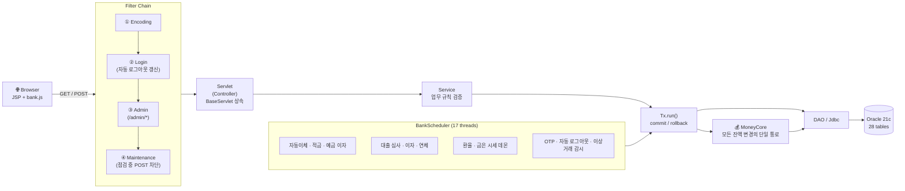

# 🏦 BankWeb (은행 업무 시스템)

## 🔗 GitHub Repository
(레포지토리 주소 입력)

---

## 📌 프로젝트 소개
BankWeb은 실제 은행 업무를 웹 홈페이지로 구현한 **Java 기반 은행 업무 시스템**입니다.
회원가입·계좌 개설부터 입출금·이체, 카드, 예약/자동이체, 적금·예금, 대출, 환전, 금·은 매매, 청약까지
은행 업무 전반을 **MVC 구조(JSP / Servlet / Service·DAO)** 로 구현했습니다.

콘솔 버전으로 먼저 설계한 Model 계층을 그대로 웹으로 옮겼으며,
팀원마다 **스레드 기능을 1개 이상** 맡아 웹 서버 안에서 총 **17개의 스레드**가 동작하도록 구현했습니다.
(자동 로그아웃, OTP 카운트다운, 자동이체 스케줄러, 실시간 환율 데몬, 대출 심사 스레드 등)

---

## 🗓 개발 기간
- 2026.11.17 ~ 2026.12.07

---

## 👥 개발 인원
총 4명 (팀 프로젝트)

- 김현호 : 회원 · 보안 · 관리자 
- 이승훈 : 계좌 · 카드 개설 · 거래 · 자동 처리
- 변성현 : 대출 · 환전 · 금은 · 청약 · 카드 관리 · 통계
- 최태영 : 증여

---

## 🛠 사용 기술

### Backend
- Java 21
- Jakarta Servlet 5.0 / JSP
- JDBC (ojdbc11)
- Apache Tomcat 10.1
- ScheduledExecutorService / Thread (멀티스레드)

### Database
- Oracle Database 21c XE

### Frontend
- HTML5 / CSS3 / JavaScript (fetch API)
- JSP

### Tools
- GitHub
- Eclipse (Dynamic Web Project)
- DBeaver / SQL Developer

---

## ✨ 주요 기능

### 👤 회원 · 보안
- 회원가입 / 로그인 / 로그아웃 (SHA-256 비밀번호 암호화)
- 회원정보 수정 · 비밀번호 변경 · 회원 탈퇴
- 자동 로그아웃 (남은 시간 카운트다운, 60초 전 경고 + 연장)
- 인증번호(OTP) 30초 만료 — 100만원 이상 이체·증여 시 필요
- 로그인 5회 실패 시 계정 잠금 → 일정 시간 후 자동 해제
- 이상 거래 감지 (단시간 고액 출금·이체 반복 시 관리자 알림)
- 알림함 (종 아이콘으로 안 읽은 알림 표시)
- 고객센터 1:1 문의

### 💳 계좌 · 카드 · 거래
- 계좌 개설 (회원 1 : 계좌 N, 계좌 비밀번호 4자리)
- 입금 / 출금 / 계좌이체 (1일 이체 한도, 계좌 비밀번호 5회 오류 잠금)
- 잔액 조회 / 거래내역 조회 (기간별)
- 계좌 해지 (잔액이 남아 있으면 해지 불가)
- 카드 발급 (계좌 1 : 카드 N), 한도 변경 · 정지 · 비밀번호 변경 · 해지
- 증여 (30% 차감 후 입금)

### ⏰ 자동 처리
- 예약 이체 (지정 시각에 1회 실행)
- 자동이체 (매일 / 매주 / 매월 반복)
- 적금 자동 납입 및 만기 처리
- 예금 이자 자동 지급
- 은행 점검 시간 (점검 중 돈이 움직이는 요청 차단, 503 점검 화면)

### 📈 대출 · 환전 · 금은 · 청약
- 대출 신청 → 단계별 심사 진행률 표시 → 승인 시 입금
- 대출 이자 자동 차감 / 연체 처리 / 상환
- 실시간 환율 변동 (USD · JPY · CNY · EUR 전광판)
- 외화 계좌 개설 및 환전 (처리 중 → 완료 상태 표시)
- 목표 환율 도달 시 알림
- 금·은 실시간 시세 변동 및 매수 / 매도
- 청약통장 개설 · 매달 자동 납입 + 이자 · 당첨 발표

### 🛠 관리자
- 관리자 대시보드
- 전체 회원 · 계좌 조회, 계정 정지 / 해제
- 이상 거래 내역 확인
- 1:1 문의 답변
- 은행 점검 일정 등록
- 청약 발표 회차 등록
- 은행 통계 조회

---

## 🧵 스레드 기능 정리

| 기능 | 사용 기법 |
|---|---|
| 자동 로그아웃 | 타이머(감시) 스레드 |
| OTP 30초 만료 | 데몬 스레드 카운트다운 |
| 로그인 잠금 자동 해제 | `schedule()` 1회 실행 |
| 이상 거래 감지 | `scheduleAtFixedRate()` 감시 스레드 |
| 예약 이체 | `schedule()` |
| 자동이체 / 적금 자동 납입 | `scheduleAtFixedRate()` |
| 예금 이자 자동 지급 | 배치 스레드 |
| 은행 점검 시간 | `volatile` 상태 플래그 + 스케줄러 |
| 대출 심사 진행률 | `Thread` + `sleep()` + `volatile` 진행률 |
| 대출 이자 차감 / 연체 처리 | 스케줄러 |
| 실시간 환율 · 금은 시세 | 데몬 스레드 |
| 환전 처리 지연 | `Thread` + `sleep()` |
| 목표 환율 알림 | 감시 스레드 |
| 청약 자동 납입 / 당첨 발표 | `scheduleAtFixedRate()` / `schedule()` |

- 모든 스레드는 `BankScheduler` 한 곳에서 관리합니다.
- Tomcat이 웹앱을 올릴 때 `AppLifecycleListener`가 스레드를 시작하고, 내릴 때 `shutdown()` + `interrupt()`로 정리합니다.
- 시연을 위해 `TimeConfig`로 시간을 가속했습니다. (예: 1개월 = 60초)

---

## 💡 핵심 구현 포인트

- **MVC 분리** : 화면은 JSP, 요청 흐름은 Servlet, 업무 규칙과 DB는 Service · DAO가 담당
- **트랜잭션 관리** : `Tx.run()` 하나로 연결 → 자동 커밋 끄기 → 작업 → 커밋 / 실패 시 롤백을 처리
- **MoneyCore** : 잔액이 바뀌는 모든 기능(입출금·이체·대출·환전·금은·청약·증여)이 한 클래스를 거침
- **동시성 제어** : `SELECT ... FOR UPDATE` 잠금, 계좌번호가 작은 순서대로 잠가 교착상태(deadlock) 방지
- **중복 실행 방지** : 스케줄러가 두 번 돌아도 `SOURCE_KEY` + UNIQUE 제약으로 같은 회차 입출금을 막음
- **PRG 패턴** : POST 처리 후 항상 redirect → 새로고침해도 이체가 두 번 되지 않음
- **이중 안전장치** : Java 검증 + DB CHECK 제약 (잔액 ≥ 0, 보유량 ≥ 0 등)
- **보안** : SHA-256 비밀번호, PreparedStatement(SQL 인젝션 방지), 출력 escape(XSS 방지), 세션 고정 방지, JSP는 `WEB-INF` 아래에 두어 직접 접근 차단

### 요청 처리 흐름
```
브라우저 ─(GET/POST)─▶ [필터 4개] ─▶ Servlet ─▶ Service ─▶ DAO ─▶ Oracle
                       ① EncodingFilter    (Controller)   (Tx.run)   (Jdbc)
                       ② LoginFilter
                       ③ AdminFilter
                       ④ MaintenanceFilter
```

---

## 🧩 팀원별 담당 기능

### 👤김현호 — 회원 · 보안 · 관리자
- 회원가입, 로그인 / 로그아웃, 회원정보 수정, 회원 탈퇴
- 자동 로그아웃, OTP 30초 만료, 로그인 잠금 / 자동 해제, 이상 거래 감지
- 관리자 로그인 · 대시보드, 전체 회원 · 계좌 조회, 계정 정지
- 고객센터 1:1 문의, 알림함(Notifier), 증여
- 공통 : DBUtil, 로그인 세션(LoginUser), BaseServlet, 필터

### 💳 이승훈 — 계좌 · 카드 개설 · 거래 · 자동 처리
- 계좌 개설 / 해지, 입금, 출금, 계좌이체, 잔액 조회, 거래내역 조회
- 카드 발급
- 예약 이체, 자동이체, 적금 자동 납입 / 만기, 예금 이자 자동 지급
- 은행 점검 시간
- 공통 : MoneyCore(입출금·이체), TxType(거래 유형), MoneyUtil(금액 계산)

### 📈 변성현 — 대출 · 환전 · 금은 · 청약 · 카드 관리 · 통계
- 대출 심사 / 이자 자동 차감 / 연체 처리 / 상환
- 실시간 환율 변동, 환전 처리 지연, 목표 환율 알림
- 금·은 실시간 시세 변동, 금·은 매수 / 매도
- 청약통장 개설, 자동 납입 + 이자, 당첨 처리
- 카드 정보 수정 / 해지, 은행 통계
- 공통 : TimeConfig(시간 가속), BankScheduler(스레드 관리)

### 💳 최태영 — 증여
- 증여 이체 / 세금 계산
---

## 🗂 프로젝트 구조
```
BankWeb/
├─ src/main/java/bank/
│   ├─ common/       공통 (DBUtil, Tx, Jdbc, BaseServlet, BankScheduler, MoneyUtil, TimeConfig ...)
│   ├─ member/       회원가입 · 로그인 · 잠금 · 수정 · 탈퇴, 메인 화면
│   ├─ security/     필터, 자동 로그아웃, OTP, 이상 거래 감시
│   ├─ notice/       알림함, 고객센터
│   ├─ admin/        관리자 대시보드 · 회원 · 계좌 · 이상거래 · 문의
│   ├─ gift/         증여
│   ├─ account/      계좌 · 입출금 · 이체 · 거래내역, MoneyCore
│   ├─ card/         카드 발급 · 수정 · 해지
│   ├─ schedule/     예약 이체 · 자동이체 스케줄러
│   ├─ savings/      적금 · 예금, 납입 · 이자 스케줄러
│   ├─ maintenance/  은행 점검
│   ├─ loan/         대출 신청 · 심사 · 이자 · 연체 · 상환
│   ├─ fx/           환율 데몬 · 환전 처리 · 목표 환율 감시
│   ├─ metal/        금 · 은 시세 데몬 · 매매
│   ├─ sub/          청약 개설 · 자동 납입 · 당첨 발표
│   └─ stats/        은행 통계
└─ src/main/webapp/
    ├─ index.jsp
    ├─ resources/css/bank.css
    ├─ resources/js/bank.js      카운트다운 · OTP · 시세 전광판 · 진행 바
    └─ WEB-INF/
        ├─ web.xml               필터 순서, 오류 화면
        ├─ lib/ojdbc11.jar
        └─ views/                JSP (서블릿을 통해서만 접근)
```
- Java 79개 · JSP 29개 (+ 공통 header/footer JSPF 2개) · CSS 1개 · JS 1개

---
## 🏗 아키텍처



| 계층 | 책임 | **하지 않는 것** |
|---|---|---|
| **JSP** (View) | 서블릿이 넘긴 데이터 출력, 모든 값 `Web.h()` escape | DB 접근, 업무 판단 |
| **Servlet** (Controller) | URL별 기능 분기, GET → forward / POST → redirect | SQL, 업무 규칙 |
| **Service / Job** (Model) | 규칙 검증, 트랜잭션 경계, 스레드 작업 | 화면 출력 |
| **DAO / Jdbc** (Model) | `?` 바인딩 SQL 실행, ResultSet → record 변환 | 업무 판단, 커밋 |

---
## ✨ ERD
시스템의 데이터베이스 구조를 나타낸 ERD입니다. (테이블 28개, 시퀀스 2개)

(ERD 이미지 첨부)

| 담당 | 테이블 |
|---|---|
| 팀원 김현호 | MEMBER, NOTIFICATION, INQUIRY, SUSPICIOUS_LOG, GIFT |
| 팀원 이승훈 | ACCOUNT, CARD, TRANSACTION_HISTORY, RESERVED_TRANSFER, AUTO_TRANSFER, SAVINGS, SAVINGS_HISTORY, TERM_DEPOSIT, DEPOSIT_INTEREST_HISTORY, BANK_MAINTENANCE |
| 팀원 변성현 | LOAN_STATUS, LOAN_PAYMENT, EXCHANGE_RATE, FOREIGN_ACCOUNT_INFO, EXCHANGE_HISTORY, RATE_ALERT, METAL_PRICE, METAL_HISTORY, METAL_HOLDING, SUBSCRIPTION, SUBSCRIPTION_PAYMENT, SUBSCRIPTION_DRAW, SUBSCRIPTION_PRIZE |
| 팀원 최태영 | 
---

## ▶ 실행 방법

1. **DB 준비** — Oracle 21c XE의 `xepdb1`에 `bank` 계정을 만들고 `1116test.sql`을 실행합니다. (테이블 생성 + 샘플 데이터)
2. **프로젝트 가져오기** — Eclipse에서 `File → Import → Existing Projects into Workspace`로 BankWeb을 가져옵니다.
3. **서버 실행** — Servers 탭에서 Tomcat v10.1에 BankWeb을 추가하고 Start 합니다.
4. **접속** — 브라우저에서 `http://localhost:8080/BankWeb` 으로 접속합니다.

> DB 접속 정보가 다르면 `bank.common.DBUtil`의 URL · USER · PASSWORD만 수정하면 됩니다.

### 테스트 계정
| 구분 | 아이디 | 비밀번호 |
|---|---|---|
| 일반 회원 | hong | 1234 |
| 관리자 | admin | 1234 |

---

## 📸 시연 화면
(추후 스크린샷 추가 예정)
